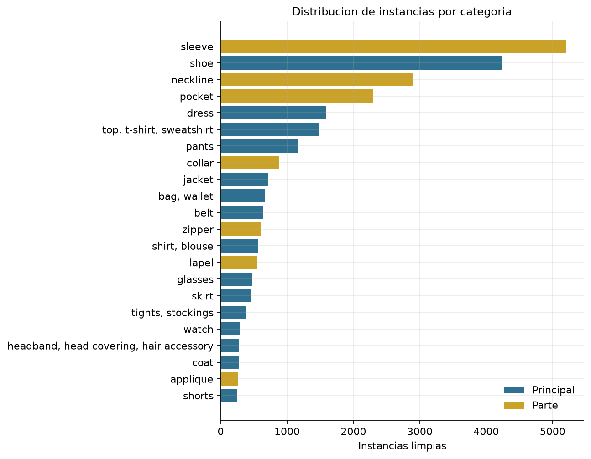
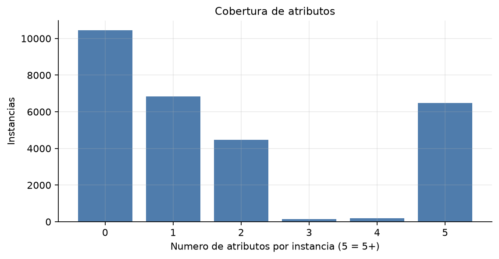
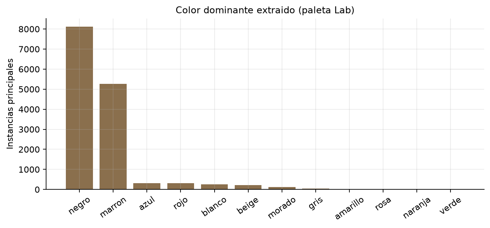
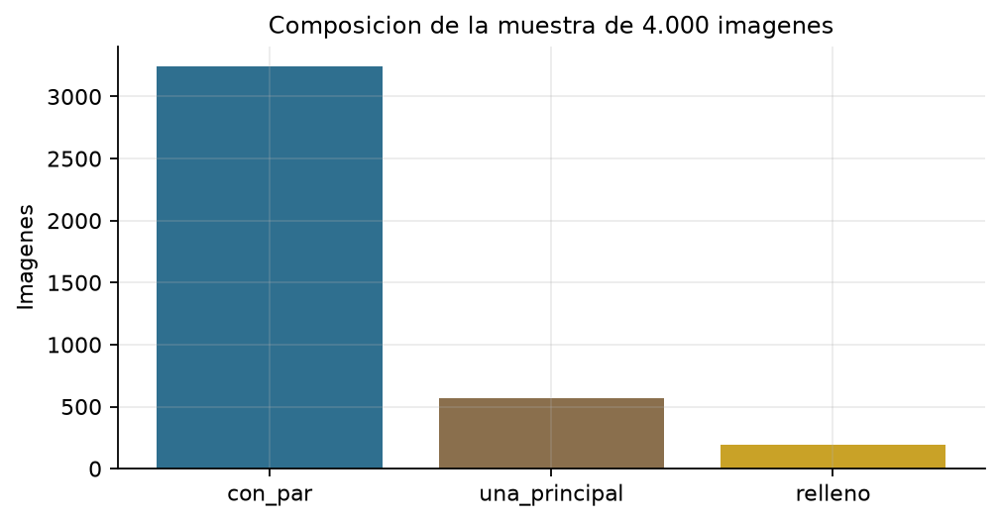
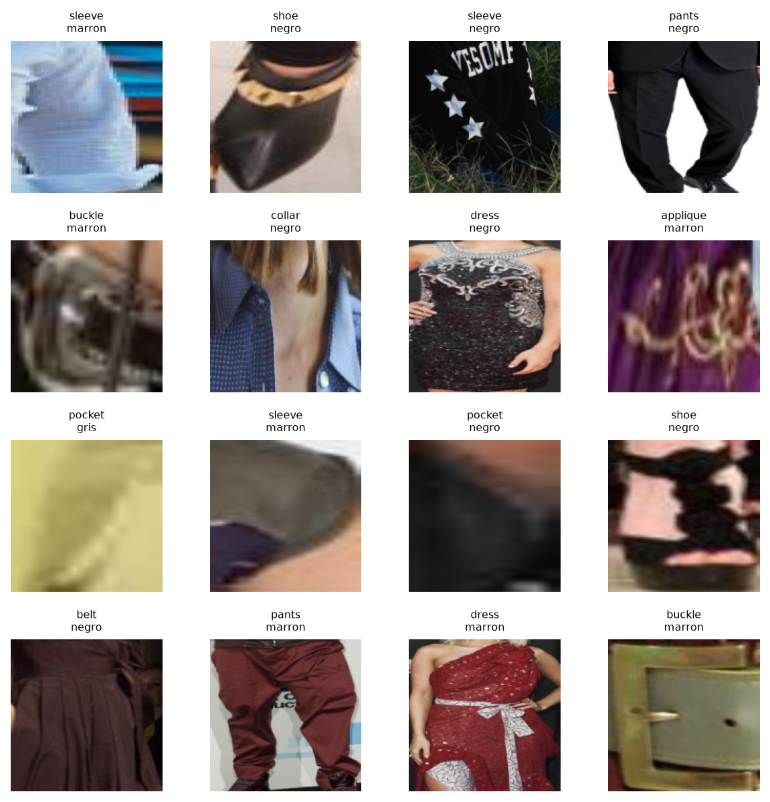

# 3.1 Dataset limpio

**Proyecto:** StyleMate · **Sprint 2** · **Escenario B (4.000 imagenes)**.

## Objetivo
Construir un dataset limpio y trazable para el Sprint 2, usando una muestra estratificada de 4.000 imagenes de Fashionpedia. El dataset completo se reutilizara en una entrega posterior con mayor tiempo de computo.

## Metodologia
1. Se identificaron las 27 categorias principales y se separaron de las partes, cierres y decoraciones.
2. Se muestrearon imagenes con pares de categorias principales y una fraccion con una sola prenda principal, estratificando por categoria dominante.
3. Se validaron categoria, `iscrowd`, bbox, area minima y segmentacion; las anotaciones sin segmentacion se conservaron con mascara de bbox.
4. Se generaron recortes RGB de 144x144 en un memmap y se extrajo el color dominante en espacio Lab con k-means y una paleta de 12 colores.

## Resultados
- Imagenes candidatas: **4,199**.
- Imagenes finales con al menos una instancia valida: **4,000**.
- Instancias finales: **28,565** (14,670 principales y 13,895 partes).
- Instancias con atributos: **18,114** (63.4 %).
- Imagenes con 2+ prendas principales: **3,365**.
- Tiempo de preparacion: **3.1 min**.

### Filtros aplicados
| Filtro | Anotaciones |
|---|---:|
| seleccionadas | 31,670 |
| area_pequena | 1,395 |
| bbox_invalida | 255 |

Se leyeron **333,401** anotaciones del JSON original; **28,565** quedaron en el dataset limpio.

## Evidencia visual

## Linaje y archivos
- `data/processed/imagenes_subset.csv`: imagenes seleccionadas.
- `data/processed/instancias_limpias.csv`: instancias validadas.
- `data/processed/recortes_144.npy`: memmap de recortes.
- `data/processed/recortes_meta.csv`: indice de recortes y color.
- `reports/metricas/3_1_resumen.json`: resumen reproducible.

## Limitaciones
- La muestra de 4.000 imagenes es representativa de Fashionpedia, pero no agota la diversidad del dataset completo.
- El color se estima desde la mascara de segmentacion; en prendas con varios colores se resume el cluster dominante.
- La coocurrencia no equivale a compatibilidad de estilo (ver 2.5).
