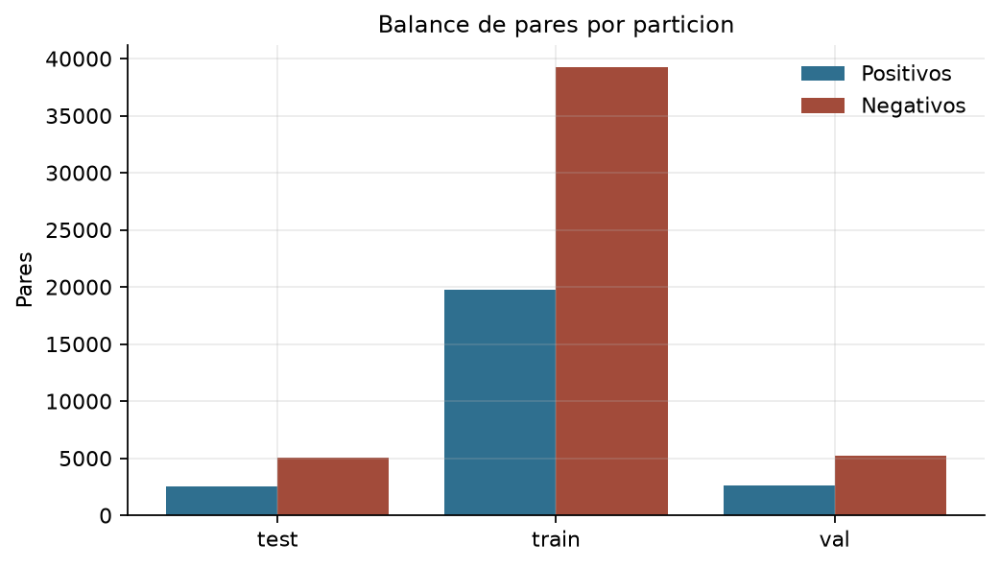
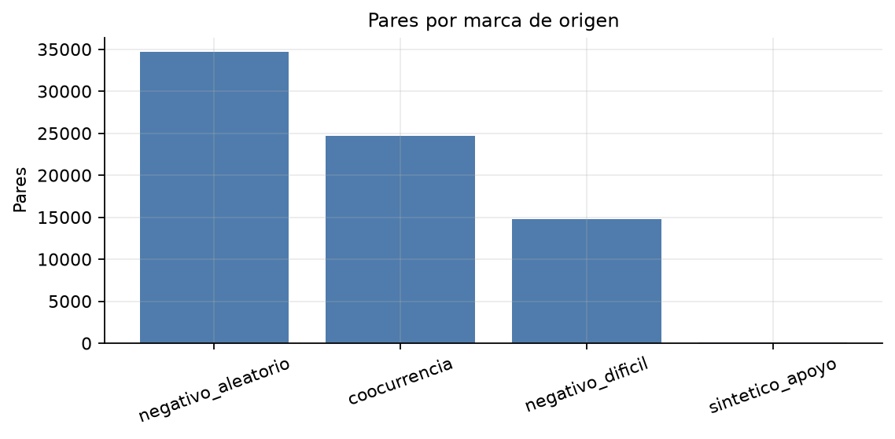
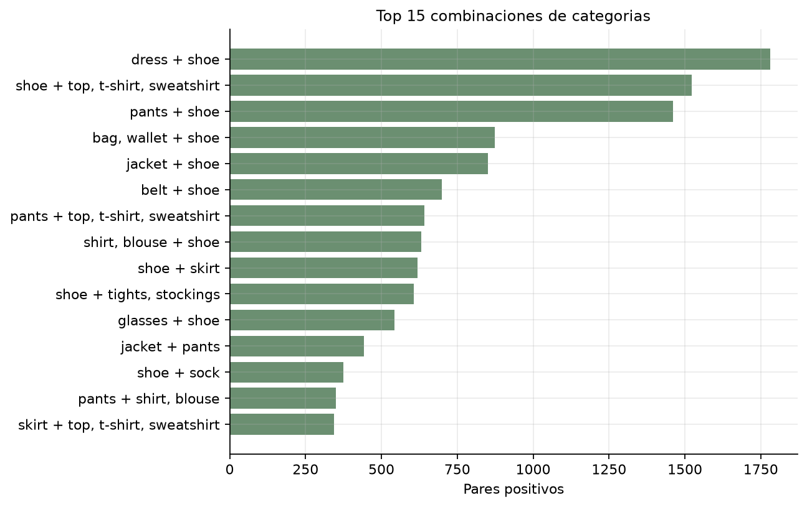
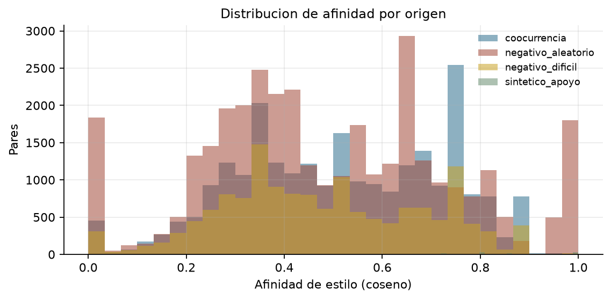
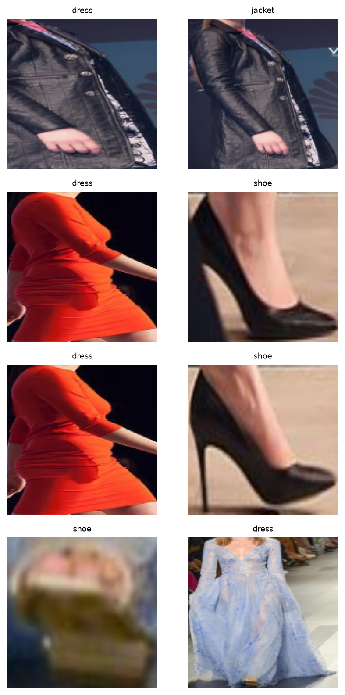

# 3.2 Dataset de pares etiquetados

## Objetivo
Generar pares positivos y negativos para entrenar el MLP de compatibilidad, aplicando la estrategia 2.5 acordada con el equipo y declarando el origen de cada etiqueta.

## Estrategia aplicada (2.5)
- **Positivos:** instancias de categorias principales distintas que coocurren en la misma imagen. Se excluyen partes de prenda, misma categoria, imagenes con menos de dos prendas principales y combinaciones redundantes.
- **Negativos:** instancias de imagenes distintas y categorias distintas. Proporcion **1:2** en esta muestra de 4.000 imagenes; el 30 % son **dificiles** (mismo par de categorias que un positivo, pero de imagenes diferentes).
- **Apoyo sintetico:** solo para pares con menos de 20 positivos en train; se generan por afinidad de atributos, se marcan y se evaluan por separado.
- **Reglas de estilo:** no se usan como fuente de etiquetas; solo la lista de pares redundantes excluye combinaciones imposibles del muestreo.
- **Sin fuga:** todos los pares se generan dentro de la particion de su imagen (3.3).

## Resultados
- Pares totales: **74,323**.
- Positivos: **24,861**; negativos: **49,462** (ratio 1.99:1).
- Pares sinteticos de apoyo: **130**.
- Combinaciones de categorias con al menos un positivo: **357**.

### Distribucion por particion
| Split | Positivos | Negativos |
|---|---:|---:|
| train | 19,736 | 39,212 |
| val | 2,617 | 5,234 |
| test | 2,508 | 5,016 |

### Top combinaciones positivas
| Combinacion | Pares |
|---|---:|
| dress + shoe | 1,782 |
| shoe + top, t-shirt, sweatshirt | 1,523 |
| pants + shoe | 1,461 |
| bag, wallet + shoe | 874 |
| jacket + shoe | 852 |
| belt + shoe | 699 |
| pants + top, t-shirt, sweatshirt | 641 |
| shirt, blouse + shoe | 632 |
| shoe + skirt | 620 |
| shoe + tights, stockings | 606 |

## Tabla 12. Fuentes de etiquetas y sus limites
| Etiqueta | Origen | Uso | Limite |
|---|---|---|---|
| Par positivo | Coocurrencia en una misma imagen | MLP de compatibilidad | La coocurrencia no equivale a compatibilidad de estilo |
| Par negativo | Prendas de imagenes distintas | MLP de compatibilidad | Puede incluir pares que si combinarian |
| Par sintetico de apoyo | Afinidad de atributos | Solo si faltan positivos | Se evalua por separado |
| Preferencia | Perfiles sinteticos con ruido | MLP de personalizacion | No representa el gusto de usuarios reales |

## Evidencia visual

## Archivos
- `data/processed/pares.csv`: pares con `label`, `origen`, `split` y afinidad.
- `data/processed/estilos_instancias.npy`: vector de estilo 40D por instancia.
- `data/processed/instancias_estilo.csv`: indice de estilos.
- `reports/metricas/3_2_resumen.json`: resumen reproducible.

## Limitaciones
- La coocurrencia refleja la composicion de Fashionpedia (desfiles y eventos), no una encuesta de compatibilidad.
- Los negativos aleatorios pueden contener combinaciones validas; el modelo aprende a separar el sesgo del muestreo, no una verdad absoluta.
- El apoyo sintetico se limita a train y se reporta aparte para no inflar las metricas de evaluacion.

Tiempo de ejecucion: 0.1 min.