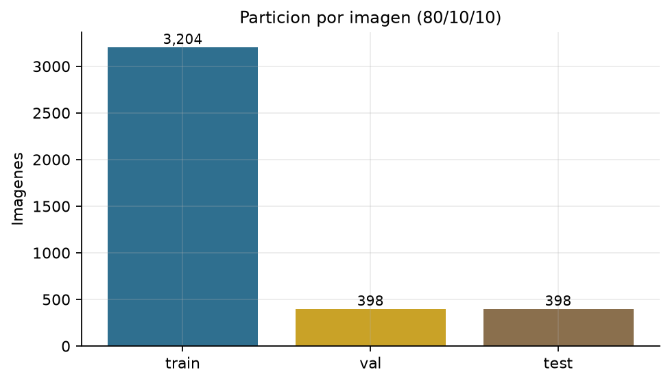
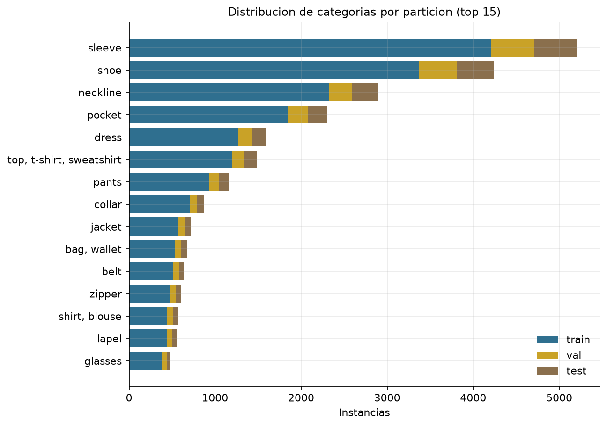
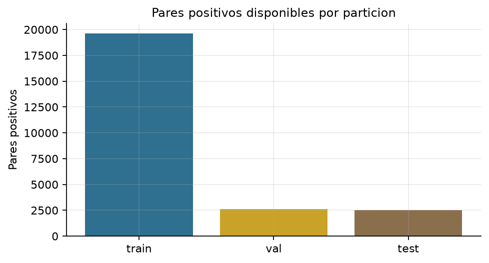

# 3.3 Conjuntos de entrenamiento, validación y prueba

## Objetivo
Asignar imagenes completas a train, val y test para evitar fuga de informacion, y definir el esquema de aumento usado por GarmentNet.

## Metodologia
- Particion **por imagen**, nunca por instancia.
- Estratificacion por **categoria dominante** de cada imagen.
- Proporcion objetivo **80/10/10**; las categorias con menos de 5 imagenes quedan completas en train para no dejar clases sin representacion.
- Los pares de compatibilidad se generan despues dentro de cada split (3.2), de modo que un par negativo nunca cruza particiones.

## Resultados
| Split | Imagenes | Instancias | Principales | Partes | Con atributos | Pares positivos |
|---|---:|---:|---:|---:|---:|---:|
| train | 3,204 | 22,825 | 11,707 | 11,118 | 14,551 | 19,606 |
| val | 398 | 2,899 | 1,501 | 1,398 | 1,781 | 2,617 |
| test | 398 | 2,841 | 1,462 | 1,379 | 1,782 | 2,508 |

Total: **4,000** imagenes y **24,731** pares positivos.

## Aumento de datos
| Tecnica | Parametro | Aplicacion |
|---|---|---|
| Volteo horizontal | p=0.5 | Solo train |
| Afinidad geometrica | rotacion +/-8 grados, traslacion 4 %, escala 0.92-1.08 | Solo train |
| Color jitter | brillo/contraste 0.15, saturacion 0.12 | Solo train |
| Normalizacion | media y desviacion 0.5 | Train/val/test |

Val y test se evaluan sin aumento, solo con normalizacion, para que las metricas sean comparables.

## Evidencia visual

## Archivos
- `data/processed/splits.json`: mapa imagen -> split.
- `data/processed/split_train.csv`, `split_val.csv`, `split_test.csv`.
- `data/processed/instancias_split.csv`: instancias con split.
- `reports/metricas/3_3_particiones.csv`.

## Limitaciones
- La estratificacion es por categoria dominante; las imagenes con varias categorias principales no se estratifican por todas ellas.
- La muestra de 4.000 imagenes reduce el numero de ejemplos por split frente al dataset completo.

Tiempo de ejecucion: 0.08 min.