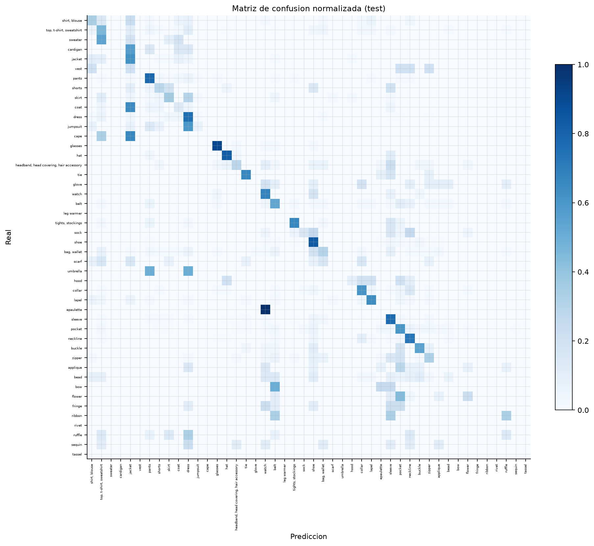

# 4.1 Modelo CNN entrenado

## Objetivo
Entrenar GarmentNet para clasificar prendas por categoria y predecir cuatro grupos de atributos, generando un embedding de 128 dimensiones que alimenta los MLP de compatibilidad y personalizacion.

## Arquitectura
- CNN residual con tallo convolucional y cuatro etapas (24, 48, 96 y 208 canales).
- Parametros entrenables: **1,805,064**.
- Entrada: recorte RGB de 144x144, normalizado con media/desviacion 0.5.
- Cabezas: categoria (46 clases), silueta (10), patron (9), largo (7), detalle (8) y embedding (128).
- Perdida: entropia cruzada ponderada para categoria + 0.25 x cada cabeza de atributos (ignorando atributos ausentes).

## Protocolo
- Train: **22,825** instancias; val: **2,899**; test: **2,841**.
- 15 epocas maximas, AdamW (lr=0.001), cosine scheduling, AMP fp16, batch 64, early stopping (paciencia 5).
- Aumento solo en train: volteo, rotacion/traslacion/escala y color jitter.

## Resultados en test
- Accuracy: **0.624**.
- Macro F1: **0.321**.
- Weighted F1: **0.615**.
- Top-3: **0.806**.
- Mejor epoca: **15**.

### Cabezas de atributos
| Cabeza | Accuracy | Macro F1 |
|---|---:|---:|
| Silueta y ajuste | 0.485 | 0.146 |
| Patron textil | 0.828 | 0.224 |
| Largo | 0.598 | 0.487 |
| Acabado / detalle | 0.699 | 0.412 |

## Evidencia visual

## Archivos
- `models/garmentnet.pt`: mejor checkpoint.
- `reports/metricas/4_1_cnn_metricas.json`: metricas de test.
- `reports/metricas/cnn_historial.csv`: historial por epoca.
- `reports/metricas/cnn_por_clase.csv`: precision/recall/F1 por categoria.

## Limitaciones
- La muestra de 4.000 imagenes reduce el soporte de clases minoritarias; varias categorias tienen muy pocos ejemplos en test.
- Las cabezas de atributos solo aprenden de instancias con atributos anotados; la cobertura es parcial (63,4 % en la muestra).
- El embedding se entrena de forma auxiliar, sin una perdida metrica especifica; su calidad se evalua indirectamente en 4.2.

Tiempo de ejecucion: 4.8 min.