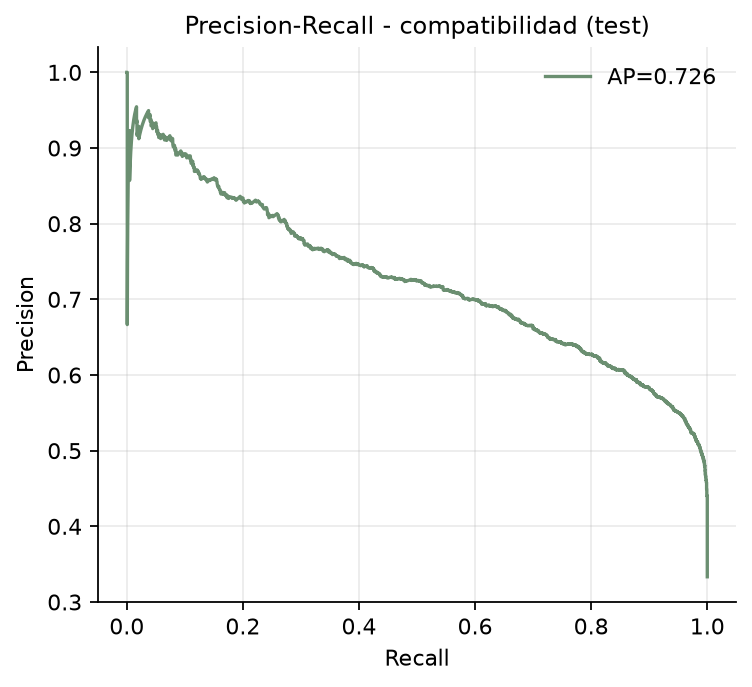
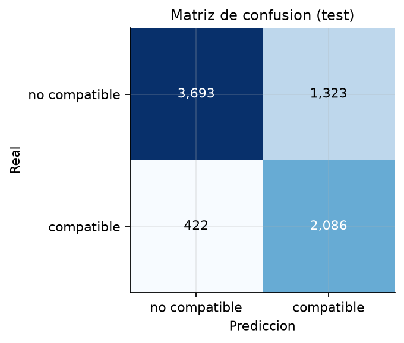
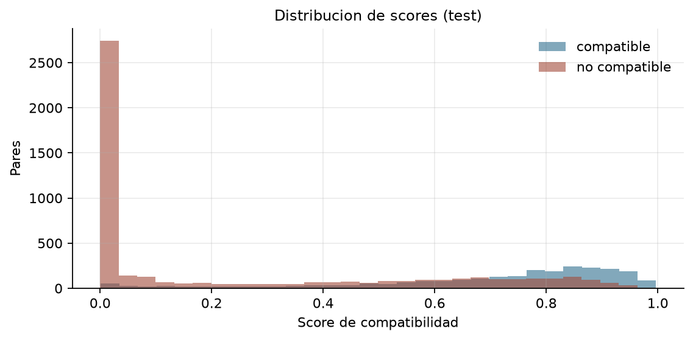

# 4.2 Modelo MLP de compatibilidad

## Objetivo
Aprender un score de compatibilidad entre dos prendas usando el embedding de GarmentNet, la categoria y el vector de estilo de 40 dimensiones.

## Diseno
- Entrada: embedding CNN de A y B (128 cada uno), diferencia absoluta (128), estilos de A y B (40 cada uno) y embeddings de categoria (16 cada uno).
- MLP 496 -> 256 -> 128 -> 64 -> 1, BatchNorm, ReLU, dropout 0.2.
- Perdida BCE con `pos_weight=2` para compensar la proporcion 1:2.
- Train/val/test heredados de 3.3; los pares sinteticos de apoyo solo estan en train y se evaluan aparte.

## Resultados en test
- AUC: **0.866**.
- AP: **0.726**.
- Accuracy: **0.768**.
- F1: **0.705** (precision 0.612, recall 0.832).
- Mejor epoca: **12**.

### Por origen
El AUC no se calcula cuando un origen contiene una sola clase. Por eso la tabla reporta el score medio y la accuracy al umbral 0,5.

| Origen | Pares | Score medio | Accuracy@0,5 |
|---|---:|---:|---:|
| coocurrencia | 2,508 | 0.705 | 0.832 |
| negativo_aleatorio | 3,457 | 0.110 | 0.887 |
| negativo_dificil | 1,559 | 0.520 | 0.402 |

## Evidencia visual

## Archivos
- `models/compat_head.pt`: checkpoint del MLP.
- `data/processed/embeddings.npy`: embeddings CNN por instancia.
- `data/processed/pares_scored.csv`: pares con score de compatibilidad.
- `reports/metricas/4_2_compat_metricas.json`.

## Limitaciones
- El score se aprende de coocurrencia, no de juicios humanos de compatibilidad.
- Los negativos aleatorios pueden ser combinaciones validas; el AUC mide separacion respecto al muestreo, no verdad absoluta.
- El embedding CNN no tuvo una perdida metricamente supervisada; el MLP compensa con categoria y estilo.

Tiempo de ejecucion: 0.7 min.