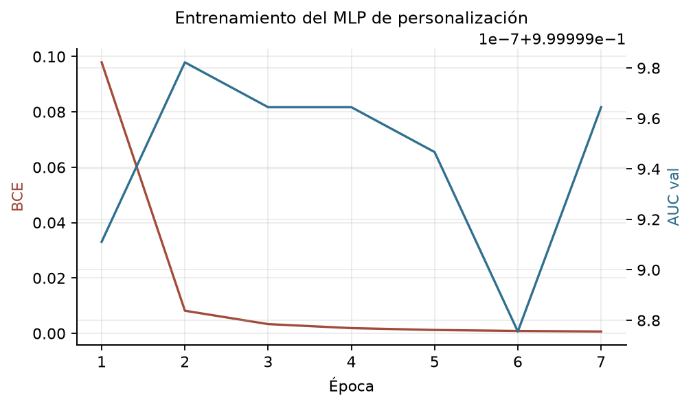
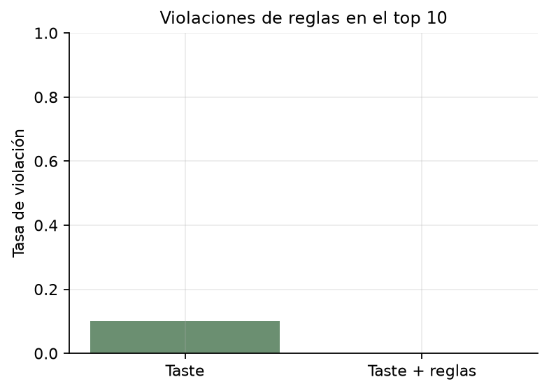

# 4.3 MLP de personalización y filtros de reglas

## Objetivo
Aprender un ranking personalizado a partir de perfiles sintéticos y aplicar reglas duras de sentido común para evitar recomendaciones incoherentes.

## Diseño
- 120 perfiles train, 30 val y 30 test, disjuntos, con 5 arquetipos y ruido creciente (0,10 / 0,15 / 0,20).
- Cada perfil genera 250 pares preferidos y 250 no preferidos por afinidad de estilo; los pares conservan su etiqueta de compatibilidad.
- Entrada (161): perfil (40), estilo medio del par (40), interacción (40), diferencia absoluta (40) y compatibilidad CNN (1). La afinidad no se usa como entrada para evitar fuga directa desde la etiqueta sintética.
- MLP 161 -> 128 -> 64 -> 1, BCE, AdamW y early stopping.
- Reglas de Sprint 1: shorts con frío, deportivo en oficina, denim formal, doble estampado y exceso de colores vivos.

## Clasificación de preferencias (test)
- AUC: **1.000**; AP: **1.000**.
- Accuracy: **1.000**; F1: **1.000**.
- Pares evaluados: **15,000**; perfiles: **30**.
- Mejor época: **2**.

## Ranking (30 perfiles test, todos los pares test)
| Sistema | NDCG@10 | HR@10 | MRR@10 |
|---|---:|---:|---:|
| Compatibilidad | 0.070 | 0.400 | 0.143 |
| Afinidad (oráculo) | 1.000 | 1.000 | 1.000 |
| Taste | 0.964 | 1.000 | 1.000 |
| Taste + reglas | 0.961 | 1.000 | 1.000 |

- Violación de reglas en top-10: **10.0%** con Taste y **0.0%** con Taste + reglas.

## Ejemplos de recomendación
| Perfil | Arquetipo | Rank | Prendas | Compat. | Taste | Penal. | Final |
|---|---|---:|---|---:|---:|---:|---:|
| test_0000 | casual | 1 | pants + top, t-shirt, sweatshirt | 0.864 | 0.999 | 0.00 | 0.999 |
| test_0000 | casual | 2 | pants + top, t-shirt, sweatshirt | 0.963 | 0.999 | 0.00 | 0.999 |
| test_0000 | casual | 3 | shoe + top, t-shirt, sweatshirt | 0.651 | 0.998 | 0.00 | 0.998 |
| test_0000 | casual | 4 | shoe + top, t-shirt, sweatshirt | 0.677 | 0.998 | 0.00 | 0.998 |
| test_0000 | casual | 5 | skirt + top, t-shirt, sweatshirt | 0.669 | 0.998 | 0.00 | 0.998 |
| test_0001 | formal | 1 | tie + vest | 0.641 | 0.998 | 0.00 | 0.998 |
| test_0001 | formal | 2 | tie + shirt, blouse | 0.591 | 0.998 | 0.00 | 0.998 |
| test_0001 | formal | 3 | dress + skirt | 0.808 | 0.998 | 0.00 | 0.998 |
| test_0001 | formal | 4 | tie + pants | 0.781 | 0.998 | 0.00 | 0.998 |
| test_0001 | formal | 5 | dress + shoe | 0.404 | 0.997 | 0.00 | 0.997 |
| test_0002 | deportivo | 1 | bag, wallet + sock | 0.038 | 0.998 | 0.00 | 0.998 |
| test_0002 | deportivo | 2 | bag, wallet + sock | 0.476 | 0.998 | 0.00 | 0.998 |
| test_0002 | deportivo | 3 | skirt + shoe | 0.870 | 0.997 | 0.00 | 0.997 |
| test_0002 | deportivo | 4 | skirt + shoe | 0.925 | 0.997 | 0.00 | 0.997 |
| test_0002 | deportivo | 5 | top, t-shirt, sweatshirt + jacket | 0.967 | 0.997 | 0.00 | 0.997 |

## Evidencia visual

## Archivos
- `models/taste_head.pt`: checkpoint del MLP.
- `data/processed/perfiles_sinteticos.json`: perfiles y vectores 40D.
- `data/processed/preferencias_sinteticas.csv`: pares elegidos por perfil.
- `data/processed/recomendaciones_test.csv`: top-5 por perfil de test.
- `reports/metricas/4_3_taste_metricas.json`.

## Limitaciones
- Las preferencias son sintéticas: la afinidad no sustituye juicios humanos.
- El ranking se evalúa contra la misma función de afinidad que genera las etiquetas; mide consistencia con el diseño, no validez de mercado.
- El score de compatibilidad de train es in-sample; en val/test es out-of-sample.

Tiempo de ejecución: 0.2 min.