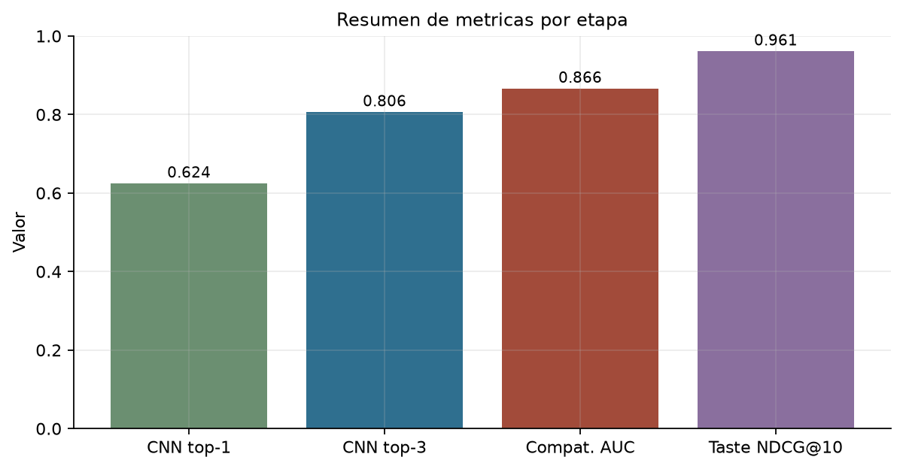
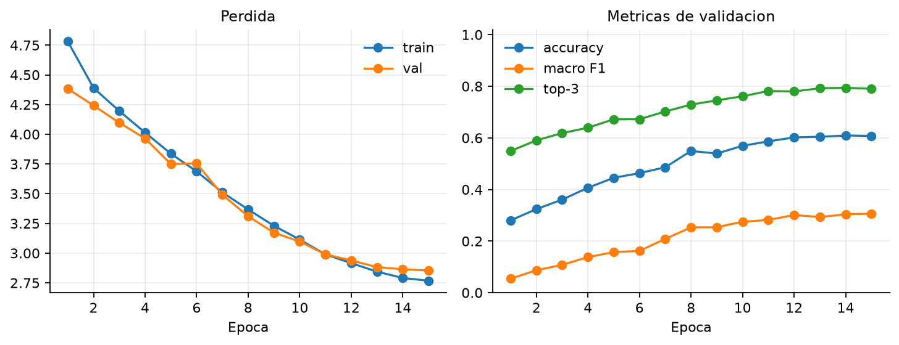
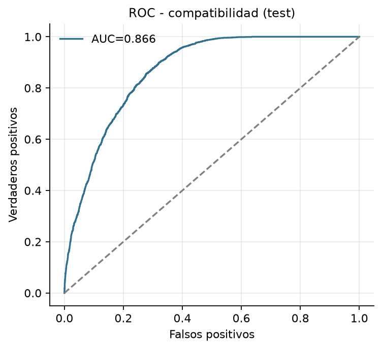
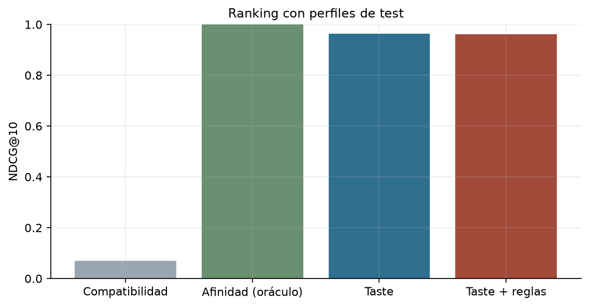

# 5.1 Reporte de métricas

Este documento reúne las metricas de las etapas 3.1 a 4.3. No son directamente comparables entre si: cada una mide una tarea distinta.

## Tabla resumen
| Bloque | Metrica | Valor | Nota |
|---|---|---:|---|
| Datos | Imagenes del subconjunto | 4,000 |  |
| Datos | Instancias | 28,565 |  |
| Datos | Instancias principales | 14,670 |  |
| Datos | Partes | 13,895 |  |
| Datos | Instancias con atributos | 18,114 | 63.4% |
| Pares | Positivos (incluye sinteticos) | 24,861 |  |
| Pares | Negativos | 49,462 |  |
| Pares | Sinteticos de apoyo | 130 |  |
| CNN | Accuracy top-1 | 0.624 |  |
| CNN | Accuracy top-3 | 0.806 |  |
| CNN | Macro F1 | 0.321 |  |
| CNN | Weighted F1 | 0.615 |  |
| CNN | Silueta (accuracy) | 0.485 |  |
| CNN | Patron (accuracy) | 0.828 |  |
| CNN | Largo (accuracy) | 0.598 |  |
| CNN | Detalle (accuracy) | 0.699 |  |
| Compatibilidad | AUC test | 0.866 |  |
| Compatibilidad | AP test | 0.726 |  |
| Compatibilidad | Accuracy test | 0.768 |  |
| Compatibilidad | F1 test | 0.705 |  |
| Taste | AUC preferencias test | 1.000 | sintetico |
| Taste | NDCG@10 | 0.964 | 30 perfiles |
| Taste + reglas | NDCG@10 | 0.961 | 30 perfiles |
| Reglas | Violacion top-10 sin reglas | 10.0% |  |
| Reglas | Violacion top-10 con reglas | 0.0% |  |

## Lectura por etapa

### Datos y pares
El subconjunto conserva **4,000 imagenes** y **28,565 instancias**. La cobertura de atributos es **63.4%**. Se generaron **24,861 positivos** y **49,462 negativos**, con **130** pares sinteticos de apoyo.

### CNN
La CNN obtiene **0.624** de accuracy top-1 y **0.806** top-3 en test. El macro F1 es **0.321**, afectado por clases con muy pocos ejemplos. La cabeza de patron es la mas fuerte (0.828) y la de silueta la mas debil (0.485).

### Compatibilidad
El MLP de compatibilidad alcanza AUC **0.866**, AP **0.726** y F1 **0.705**. Los negativos aleatorios tienen score medio bajo y los pares positivos score medio alto; los negativos dificiles quedan cerca del umbral, como se esperaba.

### Personalizacion
El MLP de taste obtiene AUC **1.000** en preferencias sinteticas. El NDCG@10 es **0.964** y baja levemente a **0.961** al aplicar reglas. La afinidad oraculo obtiene **1.000**, por lo que el modelo aprende el orden pero no supera la funcion que genero las etiquetas.

### Reglas
Las reglas reducen la violacion en el top-10 de **10.0%** a **0.0%**, con una perdida pequena de NDCG. Es el intercambio esperado entre personalizacion y coherencia.

## Evidencia visual

## Limitaciones
- El dataset es un subconjunto de 4.000 imagenes, no el dataset completo.
- Las preferencias de taste son sinteticas y no sustituyen usuarios reales.
- El macro F1 de la CNN esta penalizado por clases raras; el weighted F1 resume mejor el rendimiento global.
- Las metricas de compatibilidad y taste se evaluan sobre pares generados por coocurrencia y reglas, no sobre juicios humanos independientes.