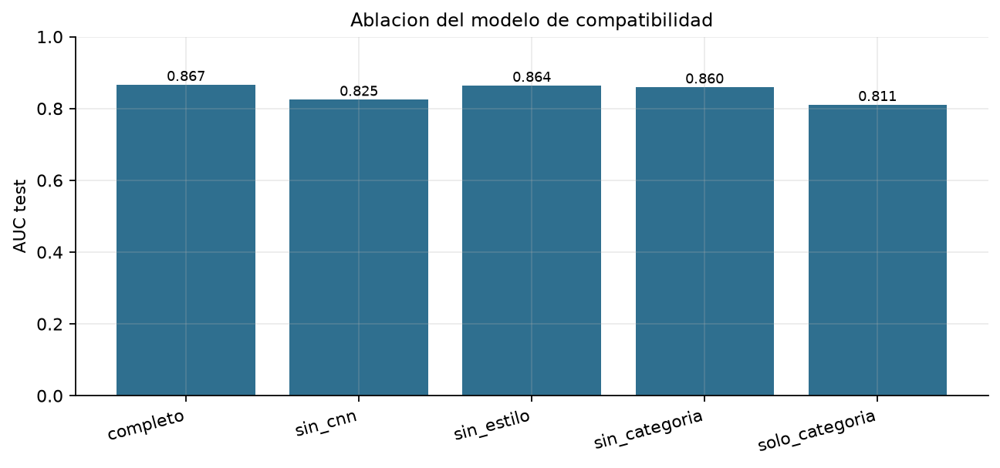

# 5.2 Reporte comparativo y de ablación

## Compatibilidad
Se reentrenó el mismo MLP cambiando solo los bloques de entrada. Las variantes sin un bloque reciben ceros en esas dimensiones, por lo que la arquitectura y el coste de inferencia se mantienen comparables.

| Variante | AUC | AP | Accuracy | F1 | Mejor época |
|---|---:|---:|---:|---:|---:|
| completo | 0.867 | 0.726 | 0.767 | 0.708 | 12 |
| sin_cnn | 0.825 | 0.624 | 0.710 | 0.683 | 6 |
| sin_estilo | 0.864 | 0.725 | 0.766 | 0.709 | 12 |
| sin_categoria | 0.860 | 0.716 | 0.760 | 0.701 | 14 |
| solo_categoria | 0.811 | 0.582 | 0.703 | 0.679 | 14 |

La comparacion principal es **completo vs sin_cnn** y **completo vs sin_estilo**. Una caida grande indica que ese bloque aporta senal; una caida pequena indica redundancia entre bloques.

## Reglas de gusto
| Configuracion | NDCG@10 | HR@10 | MRR@10 | Violacion top-10 |
|---|---:|---:|---:|---:|
| Taste sin reglas | 0.964 | 1.000 | 1.000 | 10.0% |
| Taste + reglas | 0.961 | 1.000 | 1.000 | 0.0% |

Las reglas reducen la violacion sin destruir el ranking. El coste en NDCG es el precio de imponer coherencia; el punto de operacion elegido prioriza evitar combinaciones incoherentes en el top-10.

## Limitaciones
- La ablacion se hace sobre el subconjunto de 4.000 imagenes.
- Las etiquetas de preferencia son sinteticas; la comparacion de reglas mide consistencia con el diseno, no satisfaccion de usuarios.
- Los resultados dependen de una sola semilla; no se reporta intervalo de confianza por coste computacional.

Tiempo de ejecucion: 2.6 min.