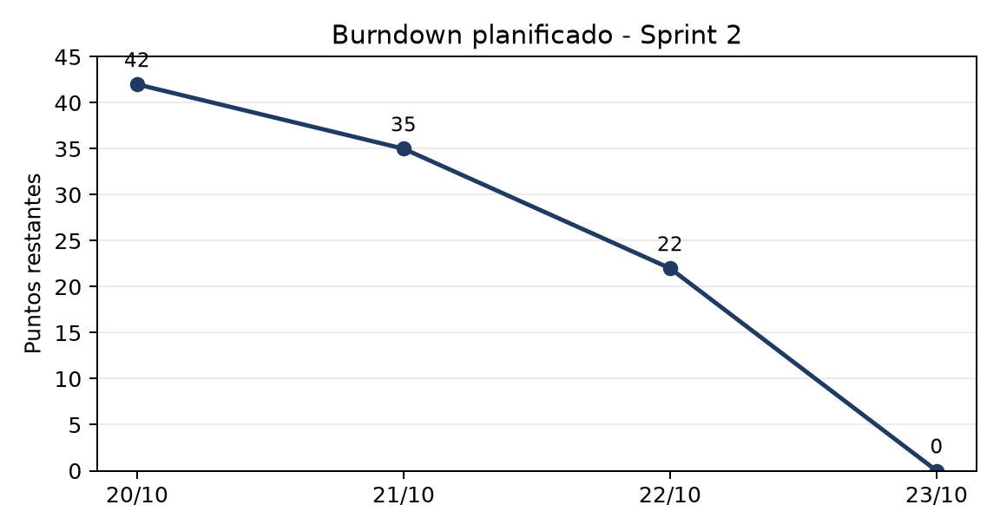

# S2.2 Burndown y Backlog actualizados

## Burndown

| Fecha | Puntos restantes | Tareas restantes | Nota |
|---|---:|---:|---|
| 20/10/2026 | 42 | 14 | Inicio del sprint |
| 21/10/2026 | 35 | 12 | Entorno y diseno |
| 22/10/2026 | 22 | 7 | Scripts preparados |
| 23/10/2026 | 0 | 0 | Cierre y documentacion |

La curva es planificada y se contrasta con el estado real del backlog. El cierre
se logro con el escenario de 4.000 imagenes; el dataset completo queda como deuda
planificada.

## Estado del backlog

| ID | Entregable | Estado | Evidencia |
|---|---|---|---|
| S2.0 | Sprint Goal y Sprint Backlog | Completado | `scrum/S2.0_Sprint_Goal_Y_Sprint_Backlog.md` |
| 3.1 | Dataset limpio | Completado | `reports/3.1_Dataset_limpio.md` |
| 3.2 | Dataset de pares etiquetados | Completado | `reports/3.2_Dataset_de_pares_etiquetados.md` |
| 3.3 | Conjuntos de entrenamiento, validación y prueba | Completado | `reports/3.3_Conjuntos_de_entrenamiento_validación_y_prueba.md` |
| 4.1 | Modelo CNN entrenado | Completado | `reports/4.1_Modelo_CNN_entrenado.md` |
| 4.2 | Modelo MLP de compatibilidad | Completado | `reports/4.2_Modelo_MLP_de_compatibilidad.md` |
| 4.3 | MLP de personalización y filtros de reglas | Completado | `reports/4.3_MLP_de_personalización_y_filtros_de_reglas.md` |
| 5.1 | Reporte de métricas | Completado | `reports/5.1_Reporte_de_métricas.md` |
| 5.2 | Reporte comparativo y de ablación | Completado | `reports/5.2_Reporte_comparativo_y_de_ablación.md` |
| S2.1 | Registro breve de dailies | Completado | `scrum/S2.1_Registro_breve_de_dailies.md` |
| S2.2 | Burndown y Backlog actualizados | Completado | `scrum/S2.2_Burndown_y_Backlog_actualizados.md` |
| S2.3 | Acta de Review | Completado | `scrum/S2.3_Acta_de_Review.md` |
| S2.4 | Acta de Retrospective | Completado | `scrum/S2.4_Acta_de_Retrospective.md` |
| DOC | Versión Word de los 13 entregables | Completado | `docs/` |

## Metricas de cierre

| Bloque | Metrica | Valor |
|---|---|---:|
| Datos | Imagenes / instancias | 4.000 / 28.565 |
| Pares | Positivos / negativos | 24.861 / 49.462 |
| CNN | Accuracy top-1 / top-3 | 0,624 / 0,806 |
| CNN | Macro F1 / weighted F1 | 0,321 / 0,615 |
| Compatibilidad | AUC / AP / F1 | 0,866 / 0,726 / 0,705 |
| Taste | NDCG@10 | 0,964 |
| Taste + reglas | NDCG@10 | 0,961 |
| Reglas | Violacion top-10 | 0,0 % |
| Ablacion | AUC completo / sin CNN | 0,867 / 0,825 |

## Backlog priorizado para la siguiente entrega

| Prioridad | Tarea | Motivo |
|---|---|---|
| Alta | Procesar dataset completo | Escalar y reducir varianza |
| Alta | Revisar clases raras | Mejorar macro F1 |
| Alta | Validacion con usuarios | Sustituir preferencias sinteticas |
| Media | Ajustar umbral de compatibilidad | Mejorar precision/recall |
| Media | Ampliar ablacion a mas semillas | Reportar intervalos |
| Baja | Revisión final de formato de entregables | Control de calidad |

## Riesgos residuales

- El macro F1 de la CNN seguira bajo mientras existan clases con pocos ejemplos.
- El taste sintetico no demuestra validez de mercado.
- Los negativos aleatorios pueden contener combinaciones validas.
- El pipeline completo requerira mas tiempo de GPU y almacenamiento.

## Conclusion

El Sprint 2 cierra con el pipeline completo, metricas verificables y documentos
trazables. La entrega es consistente con el escenario B y deja explicitas las
limitaciones y la deuda del dataset completo.
